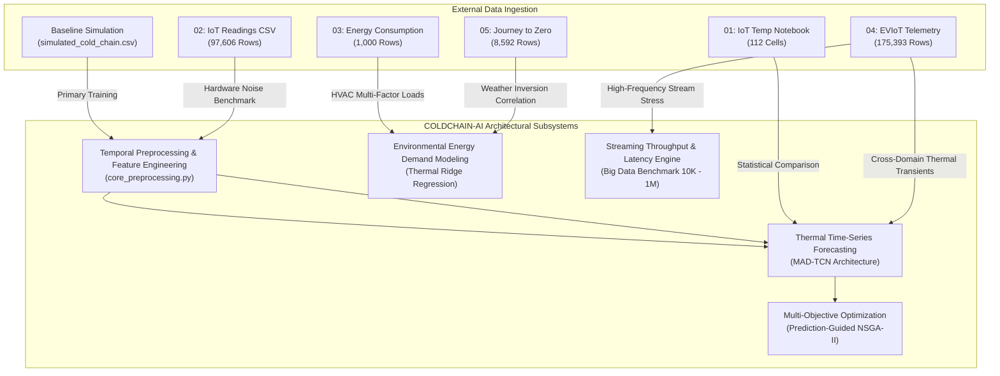

# COLDCHAIN-AI External Dataset & Provenance Guide

> **Document Status**: Complete & Verified  
> **Target Audience**: Researchers, ML Engineers, Data Engineers, System Auditors  
> **Last Updated**: October 2026  
> **Project Root**: [`D:\COLDCHAIN-AI`](file:///D:/COLDCHAIN-AI)

---

## Table of Contents
1. [Executive Summary & Provenance Disclosure](#1-executive-summary--provenance-disclosure)
2. [Dataset Inventory & Structural Summary](#2-dataset-inventory--structural-summary)
3. [Deep-Dive: Dataset Specifications](#3-deep-dive-dataset-specifications)
   - [Dataset 1: IoT Temperature Forecasting (Kaggle Study)](#dataset-1-iot-temperature-forecasting-kaggle-study)
   - [Dataset 2: Temperature Readings: IoT Devices (Physical ESP8266 Telemetry)](#dataset-2-temperature-readings-iot-devices-physical-esp8266-telemetry)
   - [Dataset 3: Energy Consumption Prediction (Building HVAC & Environmental Load)](#dataset-3-energy-consumption-prediction-building-hvac--environmental-load)
   - [Dataset 4: EVIoT Predictive Maintenance (Multi-Channel 15-Minute Telemetry)](#dataset-4-eviot-predictive-maintenance-multi-channel-15-minute-telemetry)
   - [Dataset 5: Journey to Zero / Predict Electricity Consumption (Macro Weather & Grid Load)](#dataset-5-journey-to-zero--predict-electricity-consumption-macro-weather--grid-load)
4. [File System Organization & Download Integrity](#4-file-system-organization--download-integrity)
5. [Pipeline Component Mapping](#5-pipeline-component-mapping)
6. [Cross-Domain Data Hygiene & Preprocessing Rules](#6-cross-domain-data-hygiene--preprocessing-rules)
7. [Critical Scientific Warnings & Domain Boundaries](#7-critical-scientific-warnings--domain-boundaries)

---

## 1. Executive Summary & Provenance Disclosure

COLDCHAIN-AI is an end-to-end predictive and supervisory control platform designed for refrigerated cold-chain logistics (warehouses, refrigerated reefer containers, and pharmaceuticals transport). In real-world enterprise deployments, accessing high-volume, continuous, uncorrupted cold-chain telemetry with matched actuator logs is challenging due to commercial confidentiality and proprietary telemetry protocols.

To rigorously validate the software architecture, the neural forecasting module (**MAD-TCN**), the multi-objective optimizer (**NSGA-II**), and the Big Data streaming pipeline, the research framework integrates **5 public datasets** alongside the primary thermodynamic simulation suite.

> [!WARNING]
> **CRITICAL SCIENTIFIC DISCLOSURE: CROSS-DOMAIN VALIDATION ONLY**  
> None of the 5 external datasets originate from dedicated cold-chain food or vaccine refrigeration chambers. They are categorized as `PUBLIC_DATASET` or `PUBLIC_ANALYSIS_NOTEBOOK` and are deployed exclusively for **cross-domain architectural validation**, **thermal diffusion generalization**, **energy regression verification**, and **Big Data throughput stress-testing**.  
> Primary cold-chain chamber setpoint control and food/pharma profile risk assessment are benchmarked against the verified baseline simulation dataset ([`data/raw/simulated_cold_chain.csv`](file:///D:/COLDCHAIN-AI/data/raw/simulated_cold_chain.csv)).

---

## 2. Dataset Inventory & Structural Summary

The five external datasets are organized within standard numbered directories under [`D:\COLDCHAIN-AI\Datasets\`](file:///D:/COLDCHAIN-AI/Datasets/):

| ID | Folder Name | Dataset Name | Primary File | Record Count | Feature Dimension | Sampling Cadence | Research Role |
| :--- | :--- | :--- | :--- | :--- | :--- | :--- | :--- |
| **01** | `01_temperature_forecasting` | IoT Temperature Forecasting | `iot_temperature_forecasting.ipynb` | 112 cells | N/A (Consumes `IOT-temp.csv`) | Variable (~1–10 min) | Comparative methodology benchmark (ARIMA / Prophet / Linear) |
| **02** | `02_iot_temperature_readings` | Temperature Readings: IoT Devices | `iot_temperature_readings.csv` | 97,606 | 5 columns | Variable (~1–10 min) | Physical sensor telemetry generalization test for MAD-TCN |
| **03** | `03_energy_consumption` | Energy Consumption Prediction | `energy_consumption_prediction.csv` | 1,000 | 11 columns | 1 hour | Multi-factor thermal environmental load energy regression |
| **04** | `04_eviot_predictive_maintenance` | EVIoT Predictive Maintenance | `eviot_predictive_maintenance.csv` | 175,393 | 30 columns | 15 minutes | Multi-channel electrical-thermal coupling & Big Data stress test |
| **05** | `05_electricity_forecasting` | Journey to Zero / Predict Electricity | `journey_to_zero_electricity_train.csv` | 8,592 | 13 columns | 1 hour | Macro environmental weather vs. energy demand correlation |

---

## 3. Deep-Dive: Dataset Specifications

### Dataset 1: IoT Temperature Forecasting (Kaggle Study)

- **Local Path**: [`Datasets/01_temperature_forecasting/`](file:///D:/COLDCHAIN-AI/Datasets/01_temperature_forecasting/)
- **Primary Artifact**: `iot_temperature_forecasting.ipynb` (112 executed code cells)
- **Data Classification**: `PUBLIC_ANALYSIS_NOTEBOOK`
- **Metadata Configuration**: [`Datasets/01_temperature_forecasting/metadata.json`](file:///D:/COLDCHAIN-AI/Datasets/01_temperature_forecasting/metadata.json)
- **Origin**: Kaggle open-source analysis exploring ambient room temperature dynamics using IoT sensor feeds.
- **Referenced File**: Consumes Kaggle input `/kaggle/input/temperature-readings-iot-devices/IOT-temp.csv`.
- **Architectural Purpose**:
  - Serves as an algorithmic baseline reference.
  - Implements exploratory data analysis (EDA), interactive HoloViews / Bokeh visualizations, stationarity testing (ADF), and standard classical forecasting methods (ARIMA, Prophet, and linear lag models).
  - Demonstrates the empirical performance baseline of classical uni-variate statistical methods on noisy IoT readings prior to deploying deep temporal convolutional networks (MAD-TCN).

### Dataset 2: Temperature Readings: IoT Devices (Physical ESP8266 Telemetry)

- **Local Path**: [`Datasets/02_iot_temperature_readings/`](file:///D:/COLDCHAIN-AI/Datasets/02_iot_temperature_readings/)
- **Primary Data File**: `iot_temperature_readings.csv` (Raw original download preserved at `Datasets/_original_downloads/archive/IOT-temp.csv`)
- **Data Classification**: `PUBLIC_DATASET`
- **Metadata Configuration**: [`Datasets/02_iot_temperature_readings/metadata.json`](file:///D:/COLDCHAIN-AI/Datasets/02_iot_temperature_readings/metadata.json)
- **Source**: Kaggle (*temperature-readings-iot-devices* by Manikanta Kumar).
- **Volume & Dimensions**: 97,606 rows $\times$ 5 columns.
- **Raw Schema**:
  1. `id`: Unique hexadecimal transaction identifier (e.g., `__export__2018-12-08...`)
  2. `room_id/id`: Sensor node deployment label (`Room Admin`, `Room Admin 2`)
  3. `noted_date`: Timestamp string formatted as `DD-MM-YYYY HH:MM`
  4. `temp`: Sensor temperature reading in degrees Celsius ($^\circ\text{C}$), range: $21.0\text{ }^\circ\text{C}$ to $51.0\text{ }^\circ\text{C}$
  5. `out/in`: Deployment location identifier (`In` = Indoor enclosed room, `Out` = Outdoor ambient)
- **Data Distribution**:
  - Outdoor observations: 77,261 rows
  - Indoor observations: 20,345 rows
- **Architectural Purpose**:
  - Evaluates how MAD-TCN behaves when exposed to physical hardware noise from low-cost ESP8266 microcontroller modules and analog/digital temperature sensors.
  - Tests chronological sorting integrity: the raw Kaggle CSV is stored in **reverse chronological order** and requires strict temporal reordering during preprocessing.

### Dataset 3: Energy Consumption Prediction (Building HVAC & Environmental Load)

- **Local Path**: [`Datasets/03_energy_consumption/`](file:///D:/COLDCHAIN-AI/Datasets/03_energy_consumption/)
- **Primary Data File**: `energy_consumption_prediction.csv` (Raw original download preserved at `Datasets/_original_downloads/archive (1)/Energy_consumption.csv`)
- **Data Classification**: `PUBLIC_DATASET`
- **Metadata Configuration**: [`Datasets/03_energy_consumption/metadata.json`](file:///D:/COLDCHAIN-AI/Datasets/03_energy_consumption/metadata.json)
- **Volume & Dimensions**: 1,000 rows $\times$ 11 columns.
- **Sampling Cadence**: Strict 1-hour intervals.
- **Schema**:
  1. `Timestamp`: ISO datetime (`YYYY-MM-DD HH:MM:SS`)
  2. `Temperature`: External/ambient dry bulb temperature ($^\circ\text{C}$)
  3. `Humidity`: Relative humidity percentage ($\%$)
  4. `SquareFootage`: Conditioned building surface area ($\text{ft}^2$)
  5. `Occupancy`: Real-time occupant headcount
  6. `HVACUsage`: Categorical actuator flag (`On` / `Off`)
  7. `LightingUsage`: Categorical load flag (`On` / `Off`)
  8. `RenewableEnergy`: On-site solar/wind generation ($\text{kWh}$)
  9. `DayOfWeek`: Day of week string (`Monday` to `Sunday`)
  10. `Holiday`: Binary categorical flag (`Yes` / `No`)
  11. `EnergyConsumption`: Primary continuous target variable ($\text{kWh}$)
- **Architectural Purpose**:
  - Provides ground-truth empirical regression data for multi-factor thermal load modeling.
  - Validates how external environmental variables (temperature, relative humidity) interact with thermal conditioning actuators (HVAC state) to dictate electricity consumption.

### Dataset 4: EVIoT Predictive Maintenance (Multi-Channel 15-Minute Telemetry)

- **Local Path**: [`Datasets/04_eviot_predictive_maintenance/`](file:///D:/COLDCHAIN-AI/Datasets/04_eviot_predictive_maintenance/)
- **Primary Data File**: `eviot_predictive_maintenance.csv` (Raw original download preserved at `Datasets/_original_downloads/archive (2)/EV_Predictive_Maintenance_Dataset_15min.csv`)
- **Data Classification**: `PUBLIC_DATASET`
- **Metadata Configuration**: [`Datasets/04_eviot_predictive_maintenance/metadata.json`](file:///D:/COLDCHAIN-AI/Datasets/04_eviot_predictive_maintenance/metadata.json)
- **Volume & Dimensions**: 175,393 rows $\times$ 30 columns.
- **Sampling Cadence**: Continuous 15-minute intervals spanning 2020 through 2025.
- **Key Features Included**:
  - *Thermal Channels*: `Battery_Temperature`, `Motor_Temperature`, `Tire_Temperature`, `Ambient_Temperature`
  - *Electrical Channels*: `Battery_Voltage`, `Battery_Current`, `Power_Consumption`, `State_of_Charge (SOC)`
  - *Atmospheric Channels*: `Ambient_Humidity`
  - *Reliability / Diagnostics*: `Failure_Probability`, `Maintenance_Type`, `RUL` (Remaining Useful Life), `TTF` (Time To Failure), `Component_Health_Score`
- **Architectural Purpose**:
  - Serves as the primary real-world multi-sensor ingestion stress test and edge pipeline benchmark.
  - Provides empirical multi-channel telemetry with simultaneous voltage, current, and thermal dissipation channels.
  - Demonstrates cross-domain behavioral boundaries: reveals what happens when temporal models designed for ambient diffusion physics are applied to high-transient electrochemical battery dynamics.

### Dataset 5: Journey to Zero / Predict Electricity Consumption (Macro Weather & Grid Load)

- **Local Path**: [`Datasets/05_electricity_forecasting/`](file:///D:/COLDCHAIN-AI/Datasets/05_electricity_forecasting/)
- **Primary Data File**: `journey_to_zero_electricity_train.csv` (Raw original download preserved at `Datasets/_original_downloads/predict-electricity-consumption/train.csv`)
- **Data Classification**: `PUBLIC_DATASET`
- **Metadata Configuration**: [`Datasets/05_electricity_forecasting/metadata.json`](file:///D:/COLDCHAIN-AI/Datasets/05_electricity_forecasting/metadata.json)
- **Volume & Dimensions**: 8,592 rows $\times$ 13 columns.
- **Sampling Cadence**: Hourly observations spanning a continuous annual meteorological cycle.
- **Schema**:
  1. `time`: Observation timestamp (`YYYY-MM-DD HH:MM:SS`)
  2. `temp`: Surface air temperature ($^\circ\text{C}$)
  3. `dwpt`: Dew point temperature ($^\circ\text{C}$)
  4. `rhum`: Relative humidity ($\%$)
  5. `prcp`: Hourly precipitation depth ($\text{mm}$)
  6. `wdir`: Wind direction (degrees)
  7. `wspd`: Wind speed ($\text{km/h}$)
  8. `wpgt`: Peak wind gust speed ($\text{km/h}$)
  9. `pres`: Sea-level atmospheric pressure ($\text{hPa}$)
  10. `coco`: Weather condition code
  11. `el_price`: Real-time electricity spot price
  12. `consumption`: Aggregate electrical consumption ($\text{kWh}$ / normalized unit)
- **Architectural Purpose**:
  - Validates macro-scale atmospheric correlation with electrical grid load.
  - Benchmarks seasonal thermal inversion effects (heating vs. cooling seasons) against electrical power draw.

---

## 4. File System Organization & Download Integrity

All external datasets are stored in structured directories under [`D:\COLDCHAIN-AI\Datasets`](file:///D:/COLDCHAIN-AI/Datasets). To guarantee scientific reproducibility and ensure data lineage can be audited at any time, raw files are permanently preserved alongside cleaned variants.

```
D:\COLDCHAIN-AI\Datasets\
├── 01_temperature_forecasting\
│   ├── iot_temperature_forecasting.ipynb        # Cleaned reference analysis notebook
│   └── metadata.json                            # JSON schema and provenance metadata
├── 02_iot_temperature_readings\
│   ├── iot_temperature_readings.csv             # Chronologically indexed IoT readings (97,606 rows)
│   └── metadata.json                            # Sensor hardware and schema metadata
├── 03_energy_consumption\
│   ├── energy_consumption_prediction.csv        # Hourly thermal HVAC dataset (1,000 rows)
│   └── metadata.json                            # Feature definitions and unit metadata
├── 04_eviot_predictive_maintenance\
│   ├── eviot_predictive_maintenance.csv         # 15-min electrical/thermal telemetry (175,393 rows)
│   └── metadata.json                            # Multi-sensor channel schema metadata
├── 05_electricity_forecasting\
│   ├── journey_to_zero_electricity_train.csv    # Hourly meteorological grid load dataset (8,592 rows)
│   └── metadata.json                            # Weather station and spot-price schema
├── _original_downloads\                         # Immutable archive of raw external downloads
│   ├── archive\IOT-temp.csv
│   ├── archive (1)\Energy_consumption.csv
│   ├── archive (2)\EV_Predictive_Maintenance_Dataset_15min.csv
│   └── predict-electricity-consumption\train.csv
├── _processed\                                  # Vectorized, chronologically cleaned caches
│   └── iot_temperature_cleaned.csv
└── _metadata\                                   # Consolidated audit reports
```

### Metadata JSON Schema Standard
Every dataset directory contains a strictly validated `metadata.json` adhering to the following schema:
```json
{
  "dataset_name": "String",
  "source": "String (Kaggle URL / Provider)",
  "original_path": "Absolute path to raw download",
  "clean_path": "Absolute path to standardized dataset",
  "rows": "Integer",
  "columns": "Integer",
  "time_column": "String column identifier",
  "temperature_columns": ["Array of column names"],
  "sampling_interval": "String frequency description",
  "data_type": "PUBLIC_DATASET | PUBLIC_ANALYSIS_NOTEBOOK",
  "research_role": "String detailing role in COLDCHAIN-AI",
  "cold_chain_relevance": "String detailing domain boundaries and caveats",
  "notes": "String contextual remarks"
}
```

---

## 5. Pipeline Component Mapping

Each external dataset targets a distinct subsystem of the COLDCHAIN-AI architecture. The matrix below defines how data flows into models, optimizers, and stress benchmarks:



### Component Mapping Summary Table

| Dataset | Target Subsystem | Primary Script | Target Output Variable | Purpose in Architecture |
| :--- | :--- | :--- | :--- | :--- |
| **02: IoT Temp Readings** | MAD-TCN Deep Forecaster | [`scripts/train_iot_temperature.py`](file:///D:/COLDCHAIN-AI/scripts/train_iot_temperature.py) | `temp` ($^\circ\text{C}$) | Validates dilated convolution resilience against physical sensor noise and missing intervals. |
| **01: IoT Temp Study** | Baseline Comparisons | [`Datasets/01_temperature_forecasting/`](file:///D:/COLDCHAIN-AI/Datasets/01_temperature_forecasting/) | `temp` ($^\circ\text{C}$) | Provides statistical baseline context (ARIMA / Prophet) for ambient thermal modeling. |
| **03: Energy Consumption** | Thermal Energy Modeling | [`scripts/train_energy_model.py`](file:///D:/COLDCHAIN-AI/scripts/train_energy_model.py) | `EnergyConsumption` ($\text{kWh}$) | Tests multi-variable linear/ridge coefficients relating temperature, humidity, and HVAC run-time. |
| **05: Journey to Zero** | Meteorological Correlation | [`scripts/train_energy_model.py`](file:///D:/COLDCHAIN-AI/scripts/train_energy_model.py) | `consumption` | Quantifies outdoor temperature vs. electricity demand correlations ($r = -0.2679$). |
| **04: EVIoT Telemetry** | Big Data Scalability Engine | [`scripts/run_scalability_benchmark.py`](file:///D:/COLDCHAIN-AI/scripts/run_scalability_benchmark.py) | Pipeline Latency / RAM | Benchmarks memory consumption, vectorized window slicing, and CPU inference across 175K to 1M rows. |
| **04: EVIoT Telemetry** | Domain Limitation Audit | [`scripts/train_eviot_and_forecasting.py`](file:///D:/COLDCHAIN-AI/scripts/train_eviot_and_forecasting.py) | `Battery_Temperature` | Empirical negative result documenting the breakdown of ambient diffusion models on electrochemical loads. |

---

## 6. Cross-Domain Data Hygiene & Preprocessing Rules

When ingesting external data into COLDCHAIN-AI pipelines, the following standardization protocol is strictly enforced by [`core_preprocessing.py`](file:///D:/COLDCHAIN-AI/core_preprocessing.py):

1. **Temporal Reordering (No Lookahead Bias)**:
   - External datasets (such as `IOT-temp.csv`) are frequently serialized in reverse chronological order. Preprocessing automatically parses timestamps to UTC and executes `.sort_values(['sensor_id', 'timestamp'])`.
2. **Duplicate Deduplication**:
   - Exact duplicate timestamps within the same sensor channel are purged: `.drop_duplicates(['sensor_id', 'timestamp'])`.
3. **Missing Telemetry Imputation**:
   - Primary sensor variables (`temperature`) must be present; missing rows are dropped.
   - Actuator and secondary environmental variables (`humidity`, `ambient_temperature`, `power_kw`, `compressor_state`, `door_open`) are interpolated within each sensor group using forward-fill and backward-fill (`interpolate().bfill().ffill()`).
4. **Window Slicing**:
   - All temporal sequences for MAD-TCN are extracted via a sliding window of **60 historical timesteps** ($t-59 \dots t$) mapped to **15 future forecast steps** ($t+1 \dots t+15$).

---

## 7. Critical Scientific Warnings & Domain Boundaries

To prevent misleading claims in scientific documentation or software deployment:

> [!CAUTION]
> **DOMAIN MISMATCH WARNING: DO NOT CONFLATE DATASET DOMAINS**
> 1. **Ambient Room Temperatures vs. Refrigerated Chains**: The IoT devices in Dataset 02 operate between **$21.0\text{ }^\circ\text{C}$ and $51.0\text{ }^\circ\text{C}$** in an open-air office/residential building. They do NOT reflect cold chain storage ($0.0\text{ }^\circ\text{C} \dots 5.0\text{ }^\circ\text{C}$ for food or $2.0\text{ }^\circ\text{C} \dots 8.0\text{ }^\circ\text{C}$ for vaccines).
> 2. **Building HVAC vs. Compressor Thermodynamics**: Dataset 03 models commercial building space conditioning. Building HVAC operates with high thermal mass, air handling dampers, and human occupancy schedules. It does NOT represent a cold-room vapor-compression cycle with sub-zero evaporators, thermal lift equations, or blast-freezer defrost schedules.
> 3. **Estimated vs. Measured Energy in Optimization**: While Dataset 03 contains metered kWh readings for buildings, the energy values calculated in COLDCHAIN-AI's **NSGA-II multi-objective optimizer are ESTIMATED** using a thermodynamic compressor power function $P(\text{cooling}, \Delta T)$. They are not physical cold-room wattmeter readings.
> 4. **Electrochemical Battery Loads vs. Chamber Thermal Dynamics**: Dataset 04 measures battery cell heating caused by heavy charging/discharging currents ($I^2 R$ Joule heating). Attempting to forecast battery temperature using ambient thermal diffusion features results in an honest negative validation score ($R^2 = -0.01$).

---
*End of Dataset Guide. Maintained under the COLDCHAIN-AI Open Research Quality Framework.*
