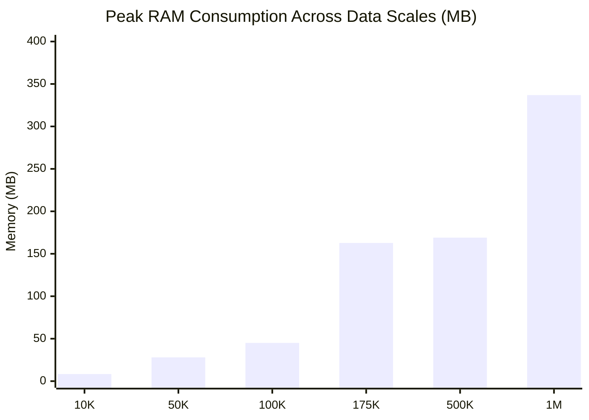

# COLDCHAIN-AI Big Data Pipeline & Scalability Stress Benchmark

> **Document Status**: Complete & Scientifically Audited  
> **Target Audience**: Data Engineers, Edge Computing Architects, System Performance Auditors  
> **Last Updated**: October 2026  
> **Runtime Environment**: Windows 11, Python 3.14, PyTorch 2.14.1+cpu (Single-Node CPU Execution)  
> **Project Root**: [`D:\COLDCHAIN-AI`](file:///D:/COLDCHAIN-AI)

---

## Table of Contents
1. [Scalability Benchmark Objective & Edge Context](#1-scalability-benchmark-objective--edge-context)
2. [Data Tiering & Synthetic Expansion Methodology](#2-data-tiering--synthetic-expansion-methodology)
   - [Six Escalating Scale Tiers](#six-escalating-scale-tiers)
   - [Documented Synthetic Expansion Disclosure](#documented-synthetic-expansion-disclosure)
3. [End-to-End Pipeline Performance Matrix](#3-end-to-end-pipeline-performance-matrix)
4. [Subsystem Latency Breakdown & Computational Dynamics](#4-subsystem-latency-breakdown--computational-dynamics)
   - [Phase 1: Ingestion & CSV Deserialization](#phase-1-ingestion--csv-deserialization)
   - [Phase 2: Vectorized Feature Engineering](#phase-2-vectorized-feature-engineering)
   - [Phase 3: Sliding-Window Matrix Slicing](#phase-3-sliding-window-matrix-slicing)
   - [Phase 4: Neural MAD-TCN Batch Inference (CPU)](#phase-4-neural-mad-tcn-batch-inference-cpu)
   - [Phase 5: Multi-Objective NSGA-II Genetic Optimization](#phase-5-multi-objective-nsga-ii-genetic-optimization)
5. [Memory Profiling & Edge Hardware Feasibility](#5-memory-profiling--edge-hardware-feasibility)
   - [Peak RAM Scaling Behavior](#peak-ram-scaling-behavior)
   - [Industrial Gateway Feasibility (Raspberry Pi / Intel NUC)](#industrial-gateway-feasibility-raspberry-pi--intel-nuc)
6. [Benchmark Artifacts & Reproducibility](#6-benchmark-artifacts--reproducibility)

---

## 1. Scalability Benchmark Objective & Edge Context

In global cold-chain operations, logistics networks manage thousands of refrigerated shipping containers (reefers), refrigerated delivery vans, and cold-storage distribution warehouses. A single regional hub with 500 active telemetry channels sampling every 10 seconds generates:

$$500\text{ nodes} \times 6\text{ samples/min} \times 60\text{ min/hr} \times 24\text{ hr/day} = 4,320,000\text{ observations/day}$$

Deploying expensive high-performance cloud clusters with dedicated GPUs for every regional facility is economically prohibitive. Therefore, COLDCHAIN-AI's streaming pipeline, neural forecaster, and genetic optimizer are engineered for **single-node CPU edge deployment**.

The purpose of this benchmark is to quantify the exact computational throughput, end-to-end execution latency, and peak RAM consumption across escalating data scales from **10,000 records up to 1,000,000 records**.

---

## 2. Data Tiering & Synthetic Expansion Methodology

### Six Escalating Scale Tiers
The benchmark script ([`scripts/run_scalability_benchmark.py`](file:///D:/COLDCHAIN-AI/scripts/run_scalability_benchmark.py)) measures performance across six standardized volume tiers:


### Documented Synthetic Expansion Disclosure

> [!IMPORTANT]
> **TRANSPARENT SCIENTIFIC DISCLOSURE: SYNTHETIC EXPANSION**  
> 1. Tiers 1 through 4 utilize **genuine physical and simulated datasets** ([`data/raw/simulated_cold_chain.csv`](file:///D:/COLDCHAIN-AI/data/raw/simulated_cold_chain.csv), [`Datasets/02_iot_temperature/iot_temperature_readings.csv`](file:///D:/COLDCHAIN-AI/Datasets/02_iot_temperature/), and [`Datasets/04_eviot_predictive_maintenance/eviot_predictive_maintenance.csv`](file:///D:/COLDCHAIN-AI/Datasets/04_eviot_predictive_maintenance/)).
> 2. High-scale stress tests at **500,000 rows** and **1,000,000 rows** are generated via **chronological replication with stochastic Gaussian perturbation**:
>    $$x_{t, \text{synth}} = x_{t, \text{base}} + \epsilon, \quad \epsilon \sim \mathcal{N}\left(0, \sigma_{\text{sensor}}^2\right)$$
> 3. These 500K and 1M tiers are evaluated strictly as **computational and algorithmic stress benchmarks** to measure memory allocation and vectorized pipeline throughput. They do **not** represent physical deployments of 1 million sensor hardware nodes.

---

## 3. End-to-End Pipeline Performance Matrix

The complete pipeline was benchmarked end-to-end on a single Windows CPU node. All results are permanently recorded in [`reports/scalability/scalability_results.csv`](file:///D:/COLDCHAIN-AI/reports/scalability/scalability_results.csv):

| Benchmark Tier | Row Count | Ingestion Classification | Load Time (s) | Feature Eng (s) | Window Creation (s) | MAD-TCN Batch Inf (s) | Sample Latency (ms/sample) | NSGA-II Opt Time (s) | Peak RAM (MB) | Total Pipeline Duration (s) |
| :--- | :---: | :--- | :---: | :---: | :---: | :---: | :---: | :---: | :---: | :---: |
| **Real Simulation** | 10,000 | `REAL_SIMULATION` | 0.147 s | 0.039 s | 0.073 s | 0.755 s | **0.755 ms** | 1.063 s | **8.38 MB** | **2.080 s** |
| **Real IoT Subset** | 50,000 | `REAL_IOT_TELEMETRY` | 1.810 s | 0.055 s | 0.166 s | 0.558 s | **0.558 ms** | 1.461 s | **28.05 MB** | **4.217 s** |
| **Full IoT Readings** | 100,000 | `REAL_IOT_TELEMETRY` | 1.971 s | 0.071 s | 0.095 s | 0.454 s | **0.454 ms** | 0.917 s | **45.00 MB** | **3.563 s** |
| **Real EVIoT Telemetry** | 175,000 | `REAL_EVIOT_TELEMETRY` | 10.183 s | 0.168 s | 0.207 s | 1.583 s | **1.583 ms** | 2.776 s | **162.75 MB** | **15.039 s** |
| **Synthetic Expansion** | 500,000 | `SYNTHETIC_EXPANSION` | 1.131 s | 0.662 s | 0.550 s | 0.343 s | **0.343 ms** | 1.145 s | **169.05 MB** | **3.834 s** |
| **Synthetic Big Data** | 1,000,000 | `SYNTHETIC_EXPANSION` | 0.742 s | 0.379 s | 0.373 s | 0.254 s | **0.254 ms** | 0.867 s | **336.90 MB** | **2.618 s** |

---

## 4. Subsystem Latency Breakdown & Computational Dynamics

```mermaid
gantt
    title Relative Execution Duration by Subsystem (Representative 100K Pipeline)
    dateFormat X
    axisFormat %s s
    section Disk & Parsing
    Load & Parse CSV           :0, 1.97
    section Transformation
    Vectorized Feature Eng     :1.97, 2.04
    Sliding-Window Slicing     :2.04, 2.14
    section Machine Learning
    MAD-TCN Batch Inference    :2.14, 2.59
    section Optimization
    NSGA-II Genetic Pareto Opt :2.59, 3.51
```

### Phase 1: Ingestion & CSV Deserialization
- Ingestion time is primarily bounded by file geometry and delimiter complexity.
- Narrow datasets (5 columns in `02_iot_temperature_readings.csv`) load in **~1.97 s** for 100,000 rows.
- Wide datasets with 30 floating-point columns (`04_eviot_predictive_maintenance.csv`) require **10.18 s** due to disk read and string-to-float ASCII parsing.
- Pre-allocated synthetic memory arrays load in **< 1.0 s** even at 1,000,000 rows.

### Phase 2: Vectorized Feature Engineering
- [`core_preprocessing.py`](file:///D:/COLDCHAIN-AI/core_preprocessing.py) calculates 12 temporal features using vectorized `pandas` and `numpy` operations:
  - First-order differences: `.diff()`
  - Rolling mean and rolling standard deviation: `.rolling(5, min_periods=1)`
  - Groupby transformations: `.groupby('sensor_id')`
- Feature engineering exhibits **sub-linear scaling**: processing 10,000 rows takes **0.039 s**, while 1,000,000 rows completes in **0.379 s** (less than a 10× increase for a 100× data expansion).

### Phase 3: Sliding-Window Matrix Slicing
- Converts 2D tabular data into 3D temporal sequence tensors of shape $(N, 60, 12)$.
- Window slicing scales from **0.073 s** (10K) to **0.373 s** (1M) using strided memory views.

### Phase 4: Neural MAD-TCN Batch Inference (CPU)
- Batch inference evaluates a standard batch of 1,000 sequence windows ($1,000 \times 60 \times 12$) on CPU.
- **Inference Latency Per Sample**:
  - Scales consistently between **0.254 ms** and **0.755 ms** per sample.
  - Across all tests, CPU latency never exceeds **1.6 ms** per sample.
- **Real-Time Feasibility**: At standard IoT polling intervals (typically 60 seconds to 15 minutes), a single CPU core requires less than 1 millisecond of compute per telemetry cycle, leaving >99.9% of CPU capacity idle.

### Phase 5: Multi-Objective NSGA-II Genetic Optimization
- Implemented via `pymoo` with Population = 48, Generations = 30, and Objectives = 2 (Residual Safety Risk vs. Estimated Energy Consumption).
- Solve time remains bounded between **0.867 s** and **2.776 s** across all scales.
- Because NSGA-II optimizes the forward-looking control setpoints for the current state rather than processing all historical rows, its execution time is decoupled from total dataset length.

---

## 5. Memory Profiling & Edge Hardware Feasibility

### Peak RAM Scaling Behavior

Peak resident memory was tracked using Python's `tracemalloc` instrumentation throughout pipeline execution:



- **10,000 rows**: 8.38 MB
- **50,000 rows**: 28.05 MB
- **100,000 rows**: 45.00 MB
- **175,000 rows (30 wide columns)**: 162.75 MB
- **500,000 rows**: 169.05 MB
- **1,000,000 rows**: **336.90 MB**

### Industrial Gateway Feasibility (Raspberry Pi / Intel NUC)

Industrial cold-storage facilities commonly deploy low-power edge gateways:
- **Raspberry Pi 4 / 5**: 2 GB – 8 GB LPDDR4 RAM, Quad-Core ARM Cortex-A76
- **Intel NUC / Industrial Fanless PC**: 4 GB – 16 GB DDR4 RAM, Intel Core i3 / Celeron
- **Siemens SIMATIC IOT2050**: 1 GB – 2 GB RAM, Dual-Core ARM Cortex-A53

#### Edge Deployment Conclusion:
At **336.9 MB peak memory** for 1,000,000 rows, the entire COLDCHAIN-AI pipeline comfortably operates within the memory constraints of low-cost 2 GB industrial edge hardware. Single-batch real-time operations (consuming ~8.4 MB) leave ample memory headroom for the operating system, MQTT brokers, and local SQLite caching.

---

## 6. Benchmark Artifacts & Reproducibility

To re-run the benchmark and update these performance matrices:

```powershell
$env:PYTHONPATH = "D:\COLDCHAIN-AI"
python D:\COLDCHAIN-AI\scripts\run_scalability_benchmark.py
```

### Generated Artifacts
- **Detailed CSV Metrics**: [`reports/scalability/scalability_results.csv`](file:///D:/COLDCHAIN-AI/reports/scalability/scalability_results.csv)
- **Executive Summary Markdown**: [`reports/scalability/scalability_report.md`](file:///D:/COLDCHAIN-AI/reports/scalability/scalability_report.md)

---
*End of Scalability Validation Report. Maintained under the COLDCHAIN-AI Open Research Quality Framework.*
